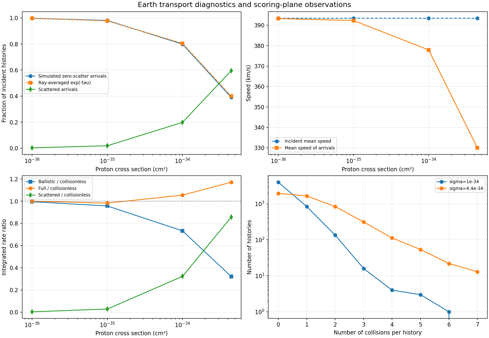
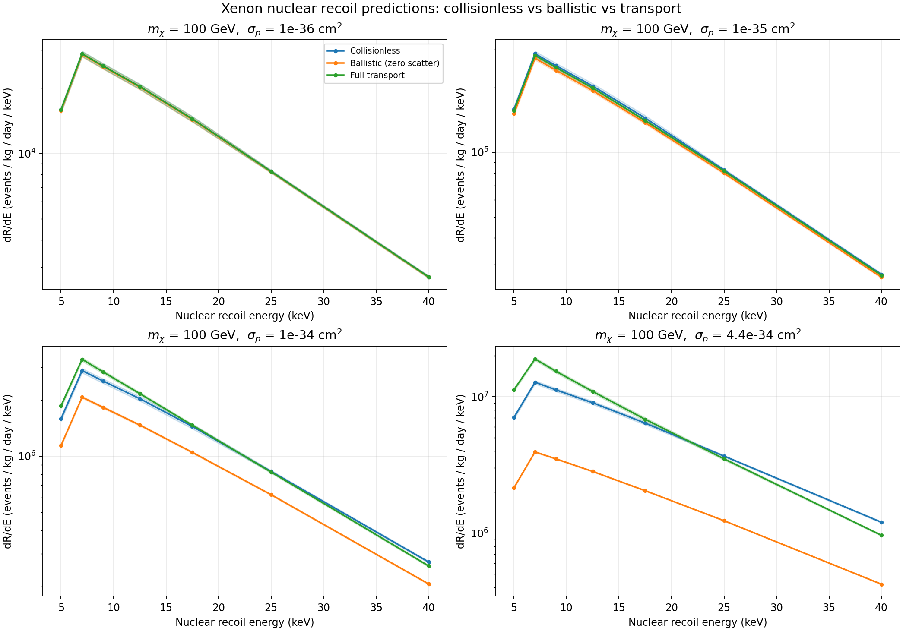

# WIMP Earth Transport: Stochastic Scattering from the Galactic Halo to an Underground Xenon Detector

**Computational astroparticle physics · Monte Carlo particle transport · Python**

This project investigates how dark-matter WIMPs propagate through an idealized terrestrial environment before reaching an underground xenon detector. The model accounts for a laboratory-frame galactic velocity distribution, a layered atmosphere, a mixed-composition crust, nuclear scattering and energy loss, and recoil-spectrum scoring.

The scientific question is not just whether particles survive their passage through matter: collisions may alter both their energies **and their directions**, which changes how many can contribute to a detector's recoil response.

## Physical workflow

1. Sample WIMP velocities from a truncated halo distribution, using the chosen laboratory-frame transformation.
2. Propagate particles through atmospheric and crustal layers with explicitly specified number densities and nuclear compositions.
3. Draw stochastic collisions using the relevant interaction rates and update particle energy and direction according to scattering kinematics.
4. Score trajectories arriving at the idealized detector plane and calculate recoil spectra for the xenon target model.
5. Compare **collisionless** (interaction-free reference), **ballistic** (zero collisions within the interacting model), and **full transport** (ballistic plus scattered trajectories), with uncertainties over initial histories.

The calculations use simplifying assumptions, including idealized geometry, composition, and detector response. These are **computational model predictions**, not experimental measurements, particle detections, or exclusion limits.

## Reproduce

Python and the dependencies listed in `requirements.txt` are required.

```bash
python3 -m pip install -r requirements.txt
python3 test_physics.py
python3 run_all.py
```

The full experiment uses stochastic simulations and may be computationally intensive. See `SCIENTIFIC_NOTES.md`, `BENCHMARK_REPORT.md`, `procedure.txt`, and `tolerance.txt` for documented inputs, methodology, frozen reference settings and validation criteria. The figures `transport_diagnostics.png` and `recoil_spectra.png` show stored outputs for the documented model configurations.

## Scientific results





Detailed numerical outputs are provided in `results.csv` and `summary.json`. Results at illustrative cross sections should not be generalized to realistic underground experiments without assessing geometry, physical assumptions, statistical convergence, and experimental constraints.

## How to navigate

| File or directory | Purpose |
| --- | --- |
| `transport_core.py` | Core transport and scattering functions |
| `solution.py` | Computational workflow and physical model implementation |
| `run_all.py` | Reproduce calculations and checks |
| `inputs/` | Atmospheric, crustal, halo, interaction and detector configurations |
| `verification.py`, `test_physics.py` | Physical and numerical consistency checks |
| `results.csv`, `summary.json` | Saved numerical outputs |
| `transport_diagnostics.png`, `recoil_spectra.png` | Scientific plots |
| `BENCHMARK_REPORT.md` | Detailed physics report and limits |

## Related project

An **independent** project, *When AI Gets Physics Wrong*, develops deterministic checks for selected simplified scientific-reasoning problems. It is not a test of an AI agent autonomously reproducing this entire WIMP simulation. See the companion repository on this GitHub profile.

## Authorship and scope

Computational-physics project and analysis maintained by the repository author. The model is idealized and is intended for scientific computation, methodological exploration, and reproducible numerical analysis. Third-party scientific methods retain their original attribution wherever used.
